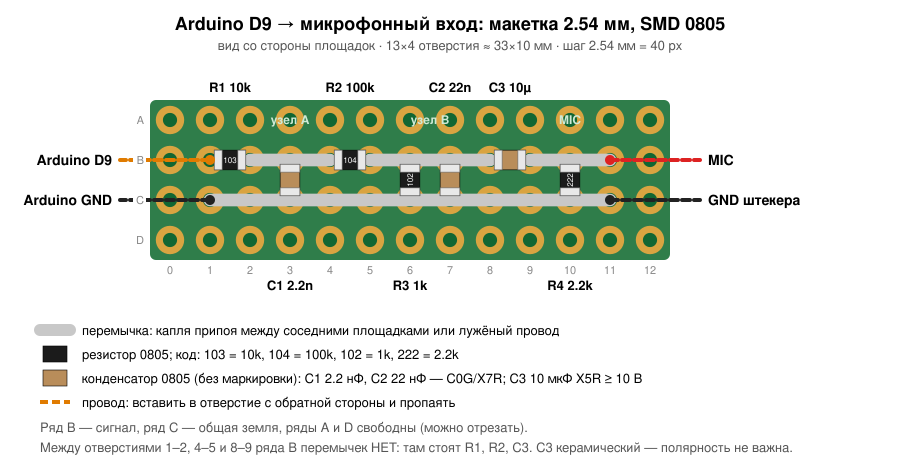

# Анализатор звука в браузере

Показывает спектрограмму, спектр, осциллограмму, уровень (RMS/пик, перегрузку), основной тон (нота + центы) и статистику сигнала с микрофонного входа компьютера.

## Запуск

Открыть `index.html` двойным щелчком в Chrome или Firefox. Нажать «Старт», разрешить доступ к микрофону и выбрать вход в списке.

Если браузер не даёт микрофон (например, Safari) или каждый раз переспрашивает разрешение, откройте страницу через локальный сервер:

```sh
cd scope
python3 -m http.server 8000
```

и зайдите на http://localhost:8000.

- Пробел — пауза (заморозка картинки).
- `?test` в адресе включает тест-сигнал сразу, `?mic` сразу открывает вход.
- Шумоподавление, эхоподавление и АРУ браузера отключены, чтобы сигнал не искажался. Уровень регулируйте усилением входа в настройках системы, а не на странице.

## Подключение Arduino Nano (D9, Mozzi) к микрофонному входу

```
          узел A               узел B
D9 ──R1 10k──┬──R2 100k──┬───────┬──C3 10µF──┬── MIC (сигнал)
             │           │       │           │
          C1 2.2nF    R3 1k   C2 22nF     R4 2.2k
             │           │       │           │
GND ─────────┴───────────┴───────┴───────────┴── GND штекера
```

| Деталь | Между | Зачем |
|---|---|---|
| R1 10 кОм | D9 – A | ФНЧ ~7 кГц вместе с C1 |
| C1 2.2 нФ | A – GND | убирает ШИМ-несущую |
| R2 100 кОм | A – B | делитель ~1:100 (5 В → ~50 мВ) |
| R3 1 кОм | B – GND | нижнее плечо делителя |
| C2 22 нФ | B – GND | второй ФНЧ ~7 кГц |
| C3 10 мкФ | B – MIC, «+» к MIC (у керамики 0805 полярности нет) | не пропускает постоянку (у ноутбука на MIC ~2–3 В смещения); срез снизу ~8 Гц |
| R4 2.2 кОм (подойдёт 1.5–4.7 кОм, например 3 кОм) | MIC – GND | изображает электретный микрофон: ток смещения идёт в него, и ноутбук «видит» микрофон |

R4 обязателен для MacBook/iPhone и многих ноутбуков с комбинированным гнездом. Они подают на MIC ~2.7 В через ~2.2 кОм и проверяют сопротивление до земли: если оно меньше 300 Ом или больше 10 кОм, смещение снимается и вход считается наушниками без микрофона. Без R4 конденсатор C3 даёт «бесконечность». Вместе с R4 сигнал на входе ~25 мВ пик.

- Землю Arduino соединить с землёй штекера. Если Nano питается по USB от того же ноутбука, петли земли не будет.
- Комбинированное гнездо ноутбука/MacBook (TRRS, CTIA): кончик — L, 1-е кольцо — R, 2-е кольцо — GND, гильза — MIC. Удобнее разветвитель «наушники + микрофон». На старых ноутбуках бывает стандарт OMTP, где MIC и GND поменяны местами (2-е кольцо — MIC, гильза — GND): если сигнала нет, попробуйте поменять их.
- Проще и безопаснее — USB-звуковая карта с розовым гнездом mic (TRS: кончик — сигнал, гильза — GND).
- Перед первым включением поставить усиление входа на минимум, потом поднимать, пока пик не будет около −12…−6 dBFS (индикатор CLIP не должен загораться).

### Монтаж на макетке 2.54 мм, SMD 0805



Корпус 0805 (2.0×1.25 мм) ложится на две соседние площадки макетки. Вид со стороны площадок. `===` — перемычка из припоя или лужёного провода, `[R]`/`[C]` — деталь лёжа, `|` — деталь поперёк рядов B–C, `●` — провод наружу:

```
     0   1   2   3   4   5   6   7   8   9   10  11  12
          R1 10k      R2 100k         C3 10µ
  A  o   o   o   o   o   o   o   o   o   o   o   o   o
  B  o   ●[R]o===o===o[R]o===o===o===o[C]o===o===●   o
                 |           |   |           |
  C  o   ●===o===o===o===o===o===o===o===o===o===●   o
  D  o   o   o   o   o   o   o   o   o   o   o   o   o
                C1          R3   C2         R4
                2.2n        1k   22n        2.2k
```

- B1–B2: R1 10k (103), B4–B5: R2 100k (104), B8–B9: C3 10 мкФ — лёжа вдоль ряда.
- B3–C3: C1 2.2 нФ, B6–C6: R3 1k (102), B7–C7: C2 22 нФ, B10–C10: R4 2.2k (222) — поперёк, на земляную шину.
- Перемычки: B2–B4 (узел A), B5–B8 (узел B), B9–B11 (MIC), C1–C11 (GND). Между B1–B2, B4–B5, B8–B9 перемычек нет.
- Провода в отверстия: B1 — D9, C1 — GND Arduino, B11 — MIC штекера, C11 — GND штекера.
- Конденсаторы: C1, C2 — C0G/NP0 или X7R; C3 — керамика X5R/X7R ≥ 10 В.

Схема сверена с готовыми решениями:
- [выходная цепь Mozzi](https://github.com/tfry-git/Mozzi): RC-фильтр 270 Ом/100 нФ, делитель, 10 мкФ;
- [«Arduino как электретный микрофон», forum.arduino.cc](https://forum.arduino.cc/t/mimic-an-electret-mic-signal/1064057): делитель 50k/1k, конденсатор параллельно 1k;
- [распиновка гарнитуры Apple и проверка микрофона по сопротивлению, pinouts.ru](https://pinouts.ru/HeadsetsHeadphones/iphone_headphone.shtml);
- [измерения смещения MIC у iPhone (2.75 В через 2.2 кОм), groupdiy](https://groupdiy.com/threads/iphone-5s-microphone-input-impendance-and-swithching-to-external-source.66440).

## Что проверить

- В настройках звука ноутбука после подключения штекера появился внешний микрофон («Внешний микрофон» / «External Microphone»). Если нет, см. раздел ниже.
- На спектрограмме видны слоги «ку-ка-ре-ку» с гармониками и паузы между криками.
- Нет постоянной горизонтальной полосы на 10–16 кГц: это была бы пролезшая ШИМ-несущая (проверьте C1/C2).
- Если крутить потенциометр на A3, график «Основной тон» смещается примерно на октаву вверх или вниз.

## MacBook не видит микрофон

Как Mac распознаёт микрофон: когда штекер вставлен, он подаёт на MIC (гильзу) ~2.7 В через ~2.2 кОм и измеряет сопротивление до GND (2-го кольца). От 300 Ом до 10 кОм — микрофон есть, обрыв или короткое замыкание — «наушники без микрофона». Проверка идёт **только в момент вставки штекера**.

```
       кончик   1-е кольцо   2-е кольцо   гильза
CTIA:    L          R           GND         MIC      ← MacBook, iPhone, большинство современных
OMTP:    L          R           MIC         GND      ← старые ноутбуки/телефоны
TRS:   сигнал       —            —          GND      ← обычный 3-контактный mic-штекер (USB-звуковая карта)
```

Частая ошибка: цепь распаяна как обычный 3-контактный штекер (сигнал на кончике, земля на гильзе). Тогда прибор показывает 2–3 кОм между **кончиком и гильзой**, а между гильзой и 2-м кольцом обрыв: Mac видит «наушники». Исправить так:
- провод MIC с платы перепаять с кончика на **гильзу**;
- провод GND с платы перепаять с гильзы на **2-е кольцо**;
- кончик и 1-е кольцо оставить свободными.

Проверка мультиметром:
1. Штекер вынут, плата подключена: **гильза ↔ 2-е кольцо ≈ 2–3 кОм** (это R4). Кончик ↔ остальные контакты — обрыв.
   - Обрыв: R4 не припаян, стоит до C3 (со стороны Arduino) или провода на других контактах.
   - ~0 Ом: замыкание (капля припоя).
   - Если MIC и GND перепутаны между собой, сопротивление то же самое — R4 стоит ровно между ними. Распознавание сработает, но сигнала может не быть (как у OMTP).
   - Показание равно номиналу R4: 2.2 кОм, 3 кОм и т.п. — всё годится, нужно лишь попасть в 300 Ом–10 кОм.
2. Штекер вставлен в Mac: постоянное напряжение **гильза ↔ 2-е кольцо ≈ 1.3–1.5 В** (2.7 В делится между 2.2 кОм в Mac и R4). 0 В — Mac снял смещение, микрофон не распознан, вернитесь к п. 1.

Ещё причины:
- Удлинитель или переходник 3-контактный (TRS) — четвёртый контакт по нему не проходит.
- Штекер не вошёл до конца (толстый корпус штекера, чехол ноутбука).
- Цепь изменили при вставленном штекере — выньте и вставьте заново.
- Смотреть: Системные настройки → Звук → Вход → «Внешний микрофон».

Обход без возни: USB-звуковая карта с отдельным розовым mic-гнездом (TRS: кончик — сигнал, гильза — GND), у неё такой проверки нет.
